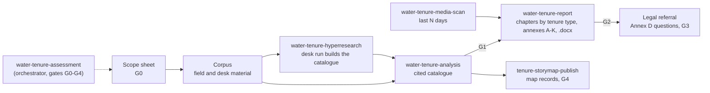

# Water Tenure Skills

Agent Skills for water tenure analysis on the FAO typology: who uses which water, where, under what
rules, and how secure those arrangements are. The skills turn field and desk evidence into a
source-cited catalogue of tenure arrangements, run exhaustive desk assessments with the hyperresearch
pipeline, scan recent news and social media at named places, build long-form reports organised by
tenure type, and publish the results to a tenure map. They are packaged as a Claude Code plugin and
work as plain `SKILL.md` folders in any agent that reads Agent Skills.

> **How this was made.** This repository was vibe-coded. The code and documentation were written by
> AI coding agents (Claude Code with Anthropic Claude models, operated as CRPG's agent "Mobot") under
> the orchestration of Mohamad Mova Al'Afghani, who set the goals, the method and the domain rules,
> and directed and reviewed the work. Treat it as research software: review it before relying on it.

The skills distil the method CRPG (Center for Regulation, Policy and Governance) uses in its water
tenure assessments. They contain no field data: every example is synthetic and set in an invented
basin.

## The skills

| Skill | What it does |
|---|---|
| [water-tenure-analysis](skills/water-tenure-analysis/SKILL.md) | The core. Catalogues arrangements from interviews, focus groups, maps, registers, archives, news and papers into cited CSV records, classified on the FAO tenure typology and use codes, graded by triangulation, with legal questions flagged and never answered. Includes the catalogue checker |
| [water-tenure-hyperresearch](skills/water-tenure-hyperresearch/SKILL.md) | Turns a generic hyperresearch deep-research run into a water tenure assessment: renders the run's query, scaffold, decomposition, domain notes and subagent protocols from one scope file; builds the catalogue inside the run, divided by tenure type |
| [water-tenure-media-scan](skills/water-tenure-media-scan/SKILL.md) | Scans the last N days of news, agency notices and social media at named places (with the last30days plugin and web search), as a catalogue in which social media are clues, never findings |
| [water-tenure-report](skills/water-tenure-report/SKILL.md) | Merges catalogues and builds the long-form report: one chapter per tenure type, maps and charts, annexes A to K, citation tokens resolved into OSCOLA or APA footnotes, mechanical checks, .docx through pandoc |
| [water-tenure-assessment](skills/water-tenure-assessment/SKILL.md) | The orchestrator: scope, which skill when, human review gates, delegation to subagents, and the AI-use statement |
| [tenure-storymap-publish](skills/tenure-storymap-publish/SKILL.md) | Publishes a catalogue to the companion storymap engine with the data-protection rules applied |



## Install

**Claude Code (plugin).** In Claude Code:

```
/plugin marketplace add movanet/water-tenure-skills
/plugin install water-tenure-skills@water-tenure-skills
```

**Manual install.** Copy or link the six folders under `skills/` into `~/.claude/skills/` (or a
project's `.claude/skills/`), keeping them side by side: the report, scan and hyperresearch skills
call the analysis skill's checker through the relative path `../water-tenure-analysis/`.

```bash
git clone https://github.com/movanet/water-tenure-skills
cp -r water-tenure-skills/skills/* ~/.claude/skills/
```

**Other agents (Codex, OpenCode and others).** The skills are plain folders with a `SKILL.md` and
scripts. [AGENTS.md](AGENTS.md) tells an agent where they are and how to use them; point your agent at
it, or copy the skill folders to wherever your agent reads skills.

**Requirements.** Python 3.9 or later. The analysis and media-scan scripts use the standard library
(PyYAML for a YAML scan scope). The report pipeline needs the packages in
[skills/water-tenure-report/requirements.txt](skills/water-tenure-report/requirements.txt) and
[pandoc](https://pandoc.org) for .docx output. Optional third-party tools, not bundled and under their
own licences: [hyperresearch](https://github.com/jordan-gibbs/hyperresearch) (MIT, tested with 0.12.0),
[last30days](https://github.com/mvanhorn/last30days-skill) (MIT, tested with 3.26.0), and any diagram
tool (the reference report used [Archify](https://github.com/tt-a1i/archify), MIT).

## Quick start on the synthetic example

From the repository root:

```bash
# 1. Check the synthetic catalogue (fictional Kali Wening basin) and build its matrix
python skills/water-tenure-analysis/scripts/check_catalogue.py skills/water-tenure-analysis/examples/synthetic-catalogue
python skills/water-tenure-analysis/scripts/build_matrix.py skills/water-tenure-analysis/examples/synthetic-catalogue --out matrix.md

# 2. Check the synthetic 30-day media scan and verify its figures against the cached pages
python skills/water-tenure-media-scan/scripts/scan_check.py skills/water-tenure-media-scan/examples/synthetic-media-scan \
    --scope skills/water-tenure-media-scan/examples/synthetic-scan-scope.yaml
python skills/water-tenure-media-scan/scripts/verify_figures.py skills/water-tenure-media-scan/examples/synthetic-media-scan \
    --cache skills/water-tenure-media-scan/examples/synthetic-media-scan/page-cache

# 3. Build the long-form report (two .docx volumes) from both catalogues
pip install -r skills/water-tenure-report/requirements.txt
python skills/water-tenure-report/scripts/run_all.py skills/water-tenure-report/examples/synthetic-config.yaml

# 4. Render the inputs of a hyperresearch run for the same basin
python skills/water-tenure-hyperresearch/scripts/make_run_inputs.py \
    skills/water-tenure-hyperresearch/examples/synthetic-scope.yaml --out run-inputs

# 5. Write a privacy-filtered publication copy for the storymap
python skills/tenure-storymap-publish/scripts/publication_copy.py \
    skills/water-tenure-analysis/examples/synthetic-catalogue --out publication
```

In Claude Code, ask for example: "Check the synthetic tenure catalogue and explain record A004", or
"Plan a water tenure assessment of <basin> with the water tenure skills".

## Tests

```bash
pip install pytest -r skills/water-tenure-report/requirements.txt
pytest
```

The tests run every script on the synthetic examples, offline. The .docx build test is skipped when
pandoc is not installed. See [CONTRIBUTING.md](CONTRIBUTING.md).

## Method and responsible use

- [docs/METHOD.md](docs/METHOD.md): the method in plain language (FAO typology, records, triangulation,
  evidence grades, the legal boundary, verification).
- [docs/RESPONSIBLE-USE.md](docs/RESPONSIBLE-USE.md): AI is never evidence; human review gates;
  protecting informants; disclosing AI use.

## Related

- Companion repository: [movanet/water-tenure-storymap](https://github.com/movanet/water-tenure-storymap),
  the tenure engine and storymap software, deployable on your own server.
- Live example of the storymap: [tenure.crpg.info](https://tenure.crpg.info) and
  [tenure.crpg.info/story](https://tenure.crpg.info/story).
- An Indonesian water tenure knowledge base: [movanet/know-crpg-tenur](https://github.com/movanet/know-crpg-tenur).
- Published works the method draws on:
  - FAO (2016). *Exploring the concept of water tenure*. Land and Water Discussion Paper 10. FAO.
  - FAO (2020). *Unpacking water tenure for improved food security and sustainable development*. FAO.
  - Hodgson, S., et al. (Eds.) (2024). *Water tenure perspectives: Proceedings of the Water Tenure
    Mondays webinar series*. FAO. https://doi.org/10.4060/cd2941en
  - AlAfghani, M. M., & Susetyo, B. (2023). Water tenure security for palm oil, hydropower, and
    geothermal. *IOP Conference Series: Earth and Environmental Science, 1199*, 012016.
  - AlAfghani, M. M., Lee, J., & Yasuda, Y. (2025). Potential contribution of the water tenure approach
    to the implementation of international norms applicable to river basins. *Journal of Energy &
    Natural Resources Law*. https://doi.org/10.1080/02646811.2025.2545686

## How to cite

If you use these skills, please cite the software (the metadata is in [CITATION.cff](CITATION.cff)):

APA:

> Al'Afghani, M. M. (2026). *Water Tenure Skills* (Version 1.0.0) [Computer software; Agent Skills
> vibe-coded with AI agents, orchestrated by the author]. CRPG - Center for Regulation, Policy and
> Governance. https://github.com/movanet/water-tenure-skills

BibTeX:

```bibtex
@software{alafghani_2026_water_tenure_skills,
  author       = {Al'Afghani, Mohamad Mova and {CRPG - Center for Regulation, Policy and Governance}},
  title        = {Water Tenure Skills},
  version      = {1.0.0},
  year         = {2026},
  date         = {2026-10-13},
  publisher    = {CRPG - Center for Regulation, Policy and Governance},
  url          = {https://github.com/movanet/water-tenure-skills},
  license      = {MIT},
  note         = {Agent Skills vibe-coded with AI agents (Claude Code), orchestrated by Mohamad Mova Al'Afghani}
}
```

## Licence

MIT, copyright 2026 CRPG - Center for Regulation, Policy and Governance (Mohamad Mova Al'Afghani).
See [LICENSE](LICENSE). Third-party tools referred to here are not included and keep their own
licences.
